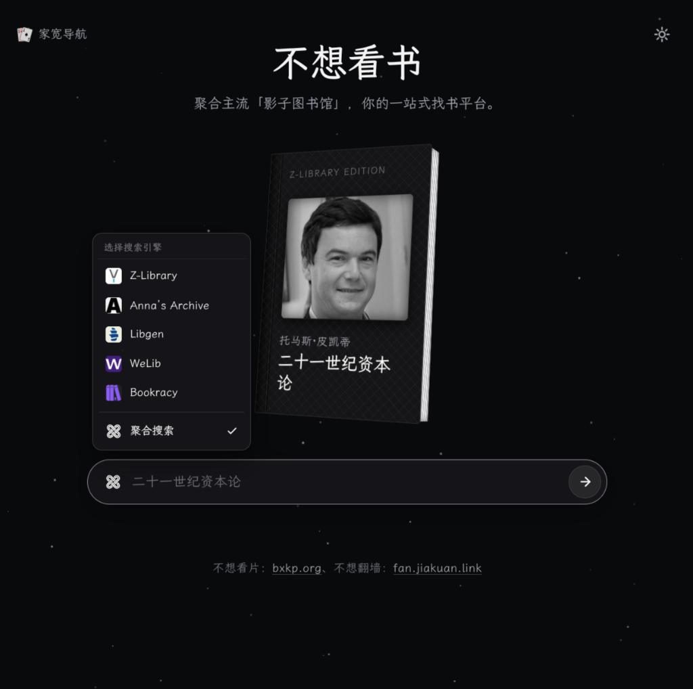
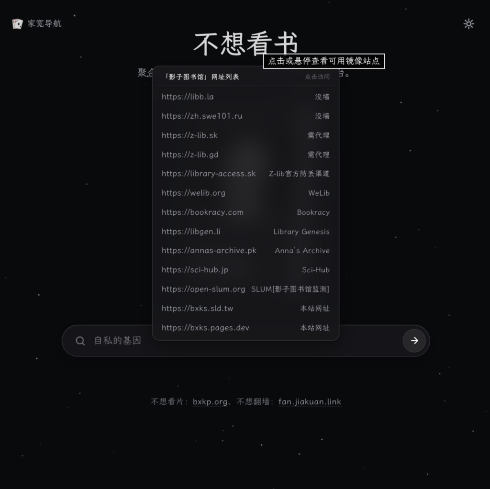

# 不想看书 (Shadow Libraries Gateway)

> **不想看书** — 聚合主流「影子图书馆」，你的一站式找书平台。  
> 🌐 在线访问：[bxks.pages.dev](https://bxks.pages.dev) ｜ 备用镜像：[bxks.sld.tw](https://bxks.sld.tw)

---

## 📱 界面预览

| 聚合搜索与引擎切换 | 可用镜像站点列表 |
| :---: | :---: |
|  |  |

---

## ✨ 核心功能

- **主流影子图书馆一站式整合**：集成 Z-Library、Anna’s Archive、Libgen、Bookracy、WeLib 等主流电子书与文献资源库，无需多站来回切换。
- **单引擎检索与一键聚合搜索**：
  - 支持快捷切换指定搜索引擎进行定向检索；
  - 提供「聚合搜索」功能，一键在新标签页中同时发起各大平台检索，全面提升查书找书效率。
- **可用镜像导航与网络状态标注**：整理各影子图书馆的最新可用镜像地址，清晰标注直连状态（免翻墙 / 需代理 / 官方防丢渠道），并支持镜像权重分流。
- **精选推荐与联动搜索**：首页动态轮播推荐经典书目，配合 3D 精装书拟真呈现，支持一键直接搜索当前推荐图书。
- **多端适配与深浅色模式**：针对桌面端与移动端深度优化操作体验，支持深色与浅色主题切换。

---

## 📄 开源协议

本项目基于 [MIT License](LICENSE) 开源。
